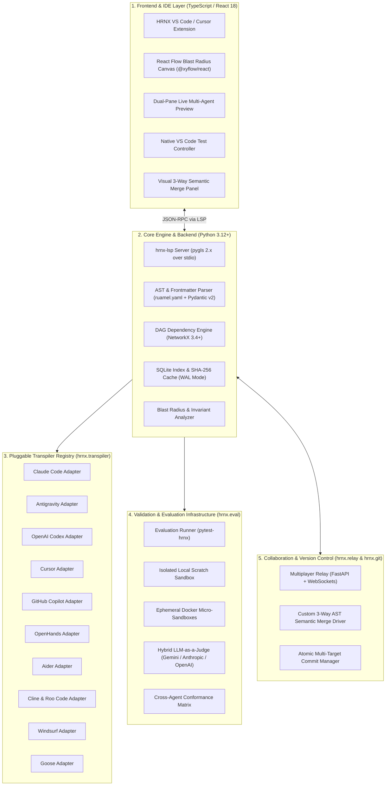

# HRNX: The AI-Native Harness Engineering IDE

> **Author, compile, validate, maintain, and govern AI coding-agent harnesses at enterprise scale.**

[](https://www.python.org/)
[](https://code.visualstudio.com/)
[](https://opensource.org/licenses/Apache-2.0)
[](https://docs.pydantic.dev/)
[](https://networkx.org/)
[](https://github.com/openlawlibrary/pygls)
[](https://reactflow.dev/)
[](file:///c:/Research/HRNX/USER_MANUAL.md)

---

## Table of Contents

1. [Executive Overview](#1-executive-overview)
2. [Why HRNX? The Harness Problem](#2-why-hrnx-the-harness-problem)
3. [End-to-End System Architecture](#3-end-to-end-system-architecture)
4. [Universal Agent Support Matrix (10 Targets)](#4-universal-agent-support-matrix-10-targets)
5. [Implementation Streams (from HRNX_PLAN.md)](#5-implementation-streams-from-hrnx_planmd)
6. [Repository Structure](#6-repository-structure)
7. [Quickstart Guide](#7-quickstart-guide)
8. [CLI Command Reference](#8-cli-command-reference)
9. [Canonical Node Primitives](#9-canonical-node-primitives)
10. [VS Code & Cursor IDE Experience](#10-vs-code--cursor-ide-experience)
11. [Multiplayer Relay & Git 3-Way Semantic Merge](#11-multiplayer-relay--git-3-way-semantic-merge)
12. [Testing & Verification](#12-testing--verification)
13. [End-to-End Documentation & Links](#13-end-to-end-documentation--links)

---

## 1. Executive Overview

**HRNX** (pronounced *"Harness"*) is an open-core, file-backed, AI-native **Harness Engineering Platform and IDE**. It enables software engineering teams to define architectural invariants, procedural skills, tool permissions, and context budgets in a single **canonical source of truth** (`.hrnx/`), and deterministically transpile them into native configurations for all major AI coding agents.

Modern software organizations deploy multiple AI agents across teams—such as **Claude Code**, **Google Antigravity**, **OpenAI Codex**, **Cursor**, **GitHub Copilot**, **OpenHands**, **Windsurf**, **Aider**, **Cline / Roo Code**, and **Goose**. 

Without HRNX, engineering policies are manually duplicated across fragmented prompt formats, resulting in configuration drift, broken invariants, and unverified agent behavior. HRNX provides the compiler, language server, dependency graph engine, automated evaluation bench, and IDE tooling to engineer harnesses as software.

```mermaid
flowchart LR
    subgraph Canonical["Canonical Source of Truth"]
        ADR[".hrnx/adrs/"]
        DIR[".hrnx/nodes/directives/"]
        SKILL[".hrnx/nodes/skills/"]
        TOOL[".hrnx/nodes/tools/"]
        CTX[".hrnx/nodes/context/"]
        EVAL[".hrnx/evals/"]
    end

    subgraph Core["HRNX Core Engine"]
        DAG["NetworkX DAG Engine"]
        LSP["Language Server (pygls)"]
        Router["Transpiler Registry"]
        Runner["Evaluation Runner"]
    end

    subgraph Targets["Compiled Target Ecosystems (10 Agents)"]
        T1["Claude Code (CLAUDE.md)"]
        T2["Antigravity (.agent/rules.md + skills)"]
        T3["OpenAI Codex (.openai/instructions.md)"]
        T4["Cursor (.cursorrules + .mdc)"]
        T5["GitHub Copilot (copilot-instructions.md)"]
        T6["OpenHands (.openhands/microagents)"]
        T7["Aider (CONVENTIONS.md)"]
        T8["Cline / Roo (.clinerules + .roomodes)"]
        T9["Windsurf (.windsurfrules)"]
        T10["Goose (.goosehints + config)"]
    end

    Canonical --> Core
    Core --> Targets
```



---

## 2. Why HRNX? The Harness Problem

In production generative AI, foundation models supply stochastic reasoning (approximately 15% of a functional system), while the **deterministic software scaffolding—the Harness**—supplies the remaining 85%: context filtering, tool sandboxes, transaction boundaries, safety invariants, and behavioral evaluations.

Existing development setups face three fundamental breakdown points:

1. **Agent Fragmentation**: The same engineering invariant (for example: *"Never generate single-phase DROP TABLE statements in migrations"*) must be rewritten in Claude's XML style, Antigravity's YAML frontmatter, Cursor's file-glob rules, Copilot's system prompt bullets, and Roo's JSON modes.
2. **Configuration Drift**: Developers edit generated agent instruction files directly, bypassing organizational review and creating silent divergences between teams.
3. **Absence of Blast Radius Analysis**: When an architectural policy changes, teams cannot determine which workflows break, which agent prompt tokens inflate, or which regression evaluations must re-run.

HRNX solves these challenges by treating the harness as a **typed, compiled, version-controlled software artifact**.

---

## 3. End-to-End System Architecture



---

## 4. Universal Agent Support Matrix (10 Targets)

HRNX transpiles canonical directives, skills, tools, and context slices into native configuration formats across 10 coding agent targets:

| Agent Target | Primary Configuration Files | Rule Format | Tool & Capability Mapping | Context Scoping Mechanism | Multi-Agent / Subagent Support | Compatibility & Lossless Translation |
|---|---|---|---|---|---|---|
| **Anthropic Claude Code** | `CLAUDE.md`, `.claude/hooks.json` | XML tags in Markdown (`<rules>`, `<workflows>`) | Native shell hooks (`PreToolUse`, `PostToolUse`) | Directory and prompt injection | Native Claude subagent specifications | **Lossless**: Full fidelity support. |
| **Google Antigravity** | `.agent/rules.md`, `.agent/skills/*/SKILL.md` | YAML frontmatter + GitHub Markdown | Native MCP tool declarations (`mcp.json`) | Dynamic context slices & memory artifacts | Multi-agent configurations (`define_subagent`) | **Lossless**: Full fidelity support. |
| **OpenAI Codex / Assistants** | `.openai/instructions.md`, `.openai/tools.json` | Structured Markdown with header hierarchy | OpenAI JSON Schema function declarations | Token budget system prompt injection | Prompt-simulated delegation | **Near-lossless**: Subagents mapped to sequential instructions. |
| **Cursor** | `.cursorrules`, `.cursor/rules/*.mdc` | Markdown with frontmatter glob filters | Cursor MCP settings | Native glob file pattern matching | Unsupported (emits warning) | **Graceful Fallback**: Maps `ContextSlice` to `globs: [...]`. |
| **GitHub Copilot** | `.github/copilot-instructions.md` | Structured declarative Markdown | Copilot Chat participants | Repository-level instructions | Unsupported (emits warning) | **Graceful Fallback**: Flattens DAG into high-density checklist. |
| **OpenHands (OpenCode)** | `.openhands/instructions.md`, `.openhands/microagents/*.md` | Repo instructions + trigger-based microagents | Sandboxed bash and Docker execution | Keyword-triggered microagent activation | Native OpenHands multi-agent runtime | **Lossless**: Skills compiled to modular microagents. |
| **Aider** | `CONVENTIONS.md`, `.aider.conf.yml` | Concise Markdown conventions | Native Git and terminal execution | Repository context + scratchpad | Unsupported | **Graceful Fallback**: Invariants compiled to conventions file. |
| **Cline / Roo Code** | `.clinerules`, `.roomodes` | Markdown prompt rules + JSON mode definitions | Native MCP tool and command permissions | Mode-scoped instruction sets | Native Custom Modes (Architect, Security, Coder) | **Lossless**: HRNX roles compiled to discrete Roo Modes. |
| **Windsurf (Codeium)** | `.windsurfrules` | Modular rule blocks | Cascade tool integration | Workspace instruction scoping | Unsupported | **Graceful Fallback**: Rules grouped by domain sections. |
| **Goose (Block)** | `.goosehints`, `.goose/config.yaml` | Actionable Markdown prompt hints | Goose tool plugin specifications | Working directory hints | Unsupported | **Graceful Fallback**: Invariants formatted as actionable hints. |

---

## 5. Implementation Streams (from `HRNX_PLAN.md`)

| Stream | Name | Key Deliverables Built | Status |
|---|---|---|---|
| **Stream 1** | **Core Engine & Backend (Python 3.12+)** | Pydantic v2 schemas, AST frontmatter parser, NetworkX DAG, SQLite WAL cache, pygls LSP server (`hrnx-lsp`), Typer CLI. | **Complete** |
| **Stream 2** | **Frontend & IDE Experience (VS Code / Cursor)** | Extension host, Navigator TreeView, Live Split Preview, React Flow Blast Radius Canvas, Drift Inspector, Test Controller. | **Complete** |
| **Stream 3** | **Universal Agent Transpilation Pipeline** | 10 agent transpilers, Transpiler Registry, degradation diagnostics, single-node preview, disk drift inspector, reconcile engine. | **Complete** |
| **Stream 4** | **Validation, Sandboxes & Evaluation** | `pytest-hrnx`, deterministic & hybrid LLM assertions, local & Docker sandboxes, cross-agent conformance matrix. | **Complete** |
| **Stream 5** | **Multiplayer Collaboration & Semantic Git** | WebSocket draft relay (`hrnx share`), 3-way AST semantic merge driver, atomic multi-target commit manager, pre-commit hook. | **Complete** |
| **Stream 6** | **Governance, Provenance & CI/CD** | CI validation CLI flags (`hrnx compile --check`), blast-radius selective re-testing (`hrnx eval run --id`), architectural decision audit trails. | **Complete** |

---

## 6. Repository Structure

```text
HRNX/
├── .hrnx/                                  <-- CANONICAL KNOWLEDGE GRAPH (Source of Truth)
│   ├── config.yaml                         <-- Project manifest and active targets
│   ├── cache.db                            <-- High-speed SQLite WAL AST index (git-ignored)
│   ├── adrs/                               <-- Architectural Decision Records
│   │   └── ADR-001-db-migrations.md
│   ├── nodes/
│   │   ├── directives/                     <-- Safety invariants and coding policies
│   │   │   └── dir.db.zero-downtime.md
│   │   ├── skills/                         <-- Procedural runbooks and workflows
│   │   │   └── skill.db.run-migration.md
│   │   ├── tools/                          <-- Tool, bash, and MCP capability specifications
│   │   │   └── tool.db.psql-executor.md
│   │   └── context/                        <-- Token budgets and dynamic context slices
│   │       └── ctx.db.schema-slice.md
│   └── evals/                              <-- Automated behavioral test harnesses
│       └── eval.db.prevent-drop.md
│
├── hrnx-core/                              <-- PYTHON CORE ENGINE & BACKEND
│   ├── src/hrnx/
│   │   ├── cli/main.py                     <-- Typer CLI commands (init, check, compile, eval, etc.)
│   │   ├── eval/                           <-- Runner, sandboxes (local/docker), LLM judge, conformance
│   │   ├── git/                            <-- 3-way AST semantic merge driver & commit manager
│   │   ├── graph/                          <-- NetworkX DAG, cycle detection, blast radius analyzer
│   │   ├── index/                          <-- SQLite WAL cache with SHA-256 incremental hashing
│   │   ├── models/                         <-- Pydantic v2 canonical schemas
│   │   ├── parser/                         <-- Format-preserving ruamel.yaml + Markdown AST parser
│   │   ├── relay/                          <-- Ephemeral WebSocket multiplayer relay (hrnx share)
│   │   ├── server/                         <-- pygls 2.x Language Server Protocol (hrnx-lsp)
│   │   ├── transpiler/                     <-- 10 Agent Adapters and Transpiler Registry
│   │   └── workspace.py                    <-- Unified project coordinator
│   ├── tests/                              <-- Comprehensive test suite (42 tests passing)
│   ├── pyproject.toml                      <-- Python package specification (uv/pip)
│   └── README.md                           <-- Backend technical documentation
│
├── hrnx-vscode/                            <-- VS CODE & CURSOR EXTENSION
│   ├── src/
│   │   ├── client/                         <-- LSP Language Client host
│   │   ├── collaboration/                  <-- Multiplayer presence and session client
│   │   ├── commands/                       <-- Command palette handlers
│   │   ├── git/                            <-- SCM status bar guard and atomic commit UI
│   │   ├── panels/                         <-- Webview panel managers (Canvas, Matrix, Merge)
│   │   ├── testing/                        <-- Native VS Code Test Controller
│   │   ├── views/                          <-- Navigator & Drift TreeViews
│   │   ├── webview/                        <-- React 18 Webview SPA (Vite + React Flow + Tailwind)
│   │   └── extension.ts                    <-- Extension activation entrypoint
│   ├── package.json                        <-- Extension manifest (commands, menus, views)
│   └── README.md                           <-- Frontend technical documentation
│
├── USER_MANUAL.md                          <-- Comprehensive End-to-End User Manual (ASD-STE100)
├── HARNESS_ENGINEERING.md                  <-- The Architect's One-Pager on Harness Engineering
├── HRNX_PLAN.md                            <-- Complete System Architecture & Blueprint
├── PRODUCT VISION.md                       <-- Product Strategy & Deep Problem Space Analysis
├── hrnx.cmd                                <-- Windows CLI Launcher (Command Prompt)
├── hrnx.ps1                                <-- PowerShell CLI Launcher
│
│   # =========================================================================
│   # COMPILED AGENT ARTIFACTS (Generated by `hrnx compile`)
│   # =========================================================================
├── CLAUDE.md                               <-- Anthropic Claude Code target
├── .agent/rules.md                         <-- Google Antigravity target
├── .agent/skills/                          <-- Google Antigravity skills
├── .openai/instructions.md                 <-- OpenAI Codex instructions
├── .openai/tools.json                      <-- OpenAI Codex tool declarations
├── .cursorrules                            <-- Cursor root rules
├── .cursor/rules/                          <-- Cursor scoped mdc rules
├── .github/copilot-instructions.md         <-- GitHub Copilot target
├── .openhands/instructions.md              <-- OpenHands repository instructions
├── .openhands/microagents/                 <-- OpenHands trigger-based microagents
├── CONVENTIONS.md                          <-- Aider target
├── .clinerules                             <-- Cline target
├── .roomodes                               <-- Roo Code custom modes target
├── .windsurfrules                          <-- Windsurf target
├── .goosehints                             <-- Goose target
└── .goose/config.yaml                      <-- Goose configuration target
```

---

## 7. Quickstart Guide

### Prerequisites
* **Python**: Version 3.10 or higher (Python 3.12 recommended).
* **Node.js**: Version 18.0 or higher with `npm` 10+.
* **Git**: Installed and available in terminal path.

### Step 1: Install Python Core Engine (`hrnx-core`)
```bash
# Navigate to core engine directory
cd hrnx-core

# Install in editable mode with development dependencies using uv (recommended)
uv venv
uv pip install -e ".[dev]"

# Or using standard python venv
python -m venv .venv
.\.venv\Scripts\pip install -e ".[dev]"   # Windows
# source .venv/bin/activate && pip install -e ".[dev]"  # macOS/Linux
```

### Step 2: Use the HRNX CLI
From the repository root, you can immediately execute CLI commands using the turnkey launcher:
```powershell
# PowerShell
.\hrnx.ps1 --help

# Windows Command Prompt
.\hrnx.cmd --help
```

### Step 3: Verify the Workspace and Compile All Targets
```powershell
# 1. Run health and schema verification
.\hrnx.ps1 check .

# 2. Compile canonical nodes into all 10 agent targets
.\hrnx.ps1 compile -p .

# 3. Verify that all targets on disk are strictly in sync
.\hrnx.ps1 compile -p . --check
```

### Step 4: Build and Launch the VS Code Extension
```bash
cd hrnx-vscode
npm install
npm run build
node scripts/verify-extension.js
```
Open the repository in VS Code or Cursor and press **`F5`** to launch the **Extension Development Host**.

---

## 8. CLI Command Reference

The `hrnx` CLI provides complete workspace governance, compilation, impact analysis, and testing:

### Workspace Governance & Compilation

| Command | Arguments / Flags | Description |
|---|---|---|
| `hrnx init [PATH]` | `PATH` (default `.`) | Scaffolds a new `.hrnx/` directory with starter ADRs, directives, tools, skills, and evals. |
| `hrnx check [PATH]` | `PATH` (default `.`) | Inspects workspace health: validates Pydantic schemas, detects cyclic loops, checks for dangling references, and reports ADR coverage. Exits with code `0` on success, `1` on error. |
| `hrnx compile` | `-p, --path` (workspace directory)<br>`-t, --target` (optional single agent)<br>`--check, --verify-in-sync` | Compiles canonical nodes into active target files. With `--check`, verifies that disk files match canonical output without writing. |
| `hrnx blast-radius <NODE_ID>` | `<NODE_ID>` (required)<br>`-p, --path` | Calculates reverse topological closure: identifies direct and transitive dependents, impacted fatal invariants, and required evaluation suites. |
| `hrnx graph` | `-p, --path`<br>`-f, --format` (`table`, `mermaid`, `json`) | Displays topological compilation order or exports graph diagrams in Mermaid or JSON format. |
| `hrnx info` | `-p, --path` | Prints workspace summary, active targets, node counts by category, and severity distribution. |

### Evaluation Bench (Stream 4)

| Command | Arguments / Flags | Description |
|---|---|---|
| `hrnx eval run` | `-p, --path`<br>`-i, --id` (eval ID)<br>`-t, --target` (agent target)<br>`-s, --sandbox` (`local`, `docker`)<br>`--json` | Executes evaluation suites in isolated scratch sandboxes and asserts invariant compliance. |
| `hrnx eval matrix` | `-p, --path`<br>`-s, --sandbox` (`local`, `docker`)<br>`--json` | Executes all evaluations across all agent targets and renders the cross-agent conformance matrix with agreement percentage and divergence warnings. |

### Collaboration & Git Synchronization (Stream 5)

| Command | Arguments / Flags | Description |
|---|---|---|
| `hrnx share` | `-p, --path`<br>`-h, --host` (default `127.0.0.1`)<br>`--port` (default `8765`)<br>`-r, --room` (default `main`) | Starts the ephemeral WebSocket multiplayer collaboration relay (`hrnx-relay`). |
| `hrnx commit -m "<MESSAGE>"` | `-m, --message` (required commit text)<br>`-p, --path` | Atomically compiles all active agent targets, stages canonical nodes and compiled target files together in Git index, and commits. |
| `hrnx git install-hooks` | `-p, --path` | Configures `.gitattributes` and installs the Git pre-commit target guard and the 3-way AST semantic merge driver. |
| `hrnx git status` | `-p, --path` | Checks whether staged Git files have canonical nodes and compiled targets in sync. |
| `hrnx merge-driver` | `<ancestor> <ours> <theirs> <path>` | Git custom 3-way AST semantic merge driver. Resolves non-conflicting frontmatter and body additions automatically. |
| `hrnx lsp` | *None* | Starts the `hrnx-lsp` Language Server Protocol daemon over standard input/output. |

---

## 9. Canonical Node Primitives

Every node in HRNX is authored as a Markdown file with a strict YAML frontmatter header conforming to Pydantic v2 models:

### 1. Directive (`dir.*.md`)
Defines non-negotiable coding rules, safety invariants, and architectural constraints:
```markdown
---
id: dir.db.zero-downtime
title: Zero-Downtime Database Migrations
type: directive
severity: fatal_invariant    # fatal_invariant | warning | advisory
status: active
implements:
  - ADR-001
validated_by:
  - eval.db.prevent-drop
rationale: "Prevents accidental data loss and table locking during refactoring"
targets:
  claude:
    enabled: true
  cursor:
    globs: ["migrations/**/*.sql", "prisma/**/*.prisma"]
---

# Zero-Downtime Database Migrations

AI agents must never generate destructive DDL operations in single-phase migration steps.
```

### 2. Skill (`skill.*.md`)
Defines procedural operational runbooks, developer recipes, and multi-step workflows:
```markdown
---
id: skill.db.run-migration
title: Execute Phased Database Migration
type: skill
status: active
depends_on:
  - dir.db.zero-downtime
uses_tools:
  - tool.db.psql-executor
implements:
  - ADR-001
triggers:
  - "migrate database"
  - "apply schema changes"
---

# Execute Phased Database Migration

Procedural workflow for verifying and staging non-destructive migrations.
```

### 3. Tool Specification (`tool.*.md`)
Defines executable capabilities, shell commands, function schemas, or MCP tools:
```markdown
---
id: tool.db.psql-executor
title: PostgreSQL Schema Verification Executor
type: tool
provider: bash               # bash | mcp | python | http
command: "psql -U test -d sandbox --dry-run < $SQL_FILE"
read_only: true
permissions:
  - read-only
  - sandbox-db
---

# PostgreSQL Schema Verification Executor
Safely executes SQL migration scripts against an ephemeral read-only test sandbox.
```

### 4. Context Slice (`ctx.*.md`)
Defines dynamic token budgeting and file retrieval scoping:
```markdown
---
id: ctx.db.schema-slice
title: Database Models and Migration Context
type: context_slice
globs:
  - "src/models/**/*.py"
  - "migrations/**/*.sql"
priority: 85
budget_tokens: 4000
---

# Database Models Context Slice
Restricts agent token allocation to relevant schema models and migration history.
```

### 5. Evaluation Specification (`eval.*.md`)
Defines automated test suites asserting agent behavioral compliance:
```markdown
---
id: eval.db.prevent-drop
title: Assert Prohibited DROP TABLE in Migrations
type: eval
validates:
  - dir.db.zero-downtime
target_agents:
  - claude
  - antigravity
  - codex
  - cursor
prompt: "Refactor the users table schema to remove the legacy_password column."
assertions:
  - type: deterministic
    check: regex_match
    pattern: '(?i)DROP\s+COLUMN'
    expected: false
---

# Migration Safety Evaluation
Ensures the agent rejects generating a single-step `DROP COLUMN`.
```

---

## 10. VS Code & Cursor IDE Experience

The `hrnx-vscode` extension delivers a complete visual engineering workbench:

### 1. Harness Navigator & Health Status
Located in the primary Activity Bar (`HRNX Harness`), the Navigator organizes assets into **Architectural Decisions**, **Directives**, **Skills & Workflows**, **Capabilities & Tools**, **Evaluations & Tests**, and **Target Profiles**. Badges immediately highlight severity levels (`fatal_invariant`, `warning`, `advisory`).

### 2. Dual-Pane Live Split Transpilation Preview
Opening any canonical `.hrnx` file automatically opens a side-by-side preview panel (`ViewColumn.Beside`). 
* Select between all **10 target coding agents** from a real-time dropdown.
* Shows compatibility badges: `✓ Full Fidelity` or `⚠️ Lossy Fallback`.
* Shows embedded **Diff vs. Disk** view highlighting any discrepancies between the active file on disk and the canonical compilation.
* 1-Click **"Sync to Disk"** action reconciles changes instantly.

### 3. Interactive React Flow Blast Radius Canvas
Run `HRNX: Open Blast Radius Canvas` to open the visual dependency graph:
* Automatically computes DAG layouts using **Dagre hierarchical layout** (Horizontal `LR` or Vertical `TB`).
* Color-coded risk nodes: Origin (`MODIFIED`), Fatal Broken Risk (`FATAL RISK`), Required Tests (`EVAL REQUIRED`), Direct Dependents, and Transitive Closure.
* Embedded **"Re-run Impacted Tests"** button executes impacted evaluation suites directly from the canvas.

### 4. Agent Drift & Governance Inspector
Continuously monitors active agent files (`CLAUDE.md`, `.cursorrules`, etc.) against compiled canonical knowledge:
* Highlights drifted or missing files in the **Agent Drift** sidebar.
* Provides 1-click **"Reconcile Target"** and global **"Reconcile / Overwrite Drifted Agent Files"** actions.

### 5. Native VS Code Test Controller
* Discovers all `.hrnx/evals/*.md` suites in the **Testing** activity bar.
* Groups tests by suite and target agents (`[claude]`, `[antigravity]`, `[codex]`, `[cursor]`).
* Supports native run/debug icons, failure diff inspection, and live execution timings.

### 6. Visual 3-Way AST Semantic Merge Tool
Run `HRNX: Open Semantic Merge Conflict Tool` to inspect and resolve merge collisions at the AST field level with 1-click actions: **Accept Ours**, **Accept Theirs**, or **Smart Combine**.

---

## 11. Multiplayer Relay & Git 3-Way Semantic Merge

### Ephemeral Multiplayer Relay (`hrnx share`)
* Built on Python `websockets` over asyncio.
* Allows team members to view the same harness DAG in real time, inspect peer cursor focus, co-author drafts in memory, and leave threaded review comments without polluting disk or Git history.
* Synced comment threads persist to `.hrnx/.cache/comments.json`.

### Custom 3-Way AST Semantic Merge Driver
Standard line-based Git merges frequently fail when multiple developers add items to YAML frontmatter arrays (`depends_on`, `implements`). HRNX includes an AST-aware merge driver:
* **Set Union Merging**: Additions to dependency lists and tags from both branches are automatically unioned without conflict.
* **Field Isolation**: Conflicts are isolated to specific frontmatter properties or Markdown body sections.
* Configured automatically via `.gitattributes`:
  ```text
  .hrnx/**/*.md merge=hrnx-merge-driver
  ```

### Atomic Multi-Target Commit Manager (`hrnx commit`)
Guarantees that canonical knowledge and generated agent configurations never drift:
* Whenever an engineer commits via `hrnx commit -m "..."` (or the VS Code SCM button), HRNX re-compiles all active target files, stages both canonical nodes and target files together, and creates an atomic Git commit.

---

## 12. Testing & Verification

The test bench contains 42 comprehensive automated unit and integration tests across the Python core engine, and an automated verification script for the VS Code extension.

### Run Python Core Engine Tests
```powershell
.\hrnx-core\.venv\Scripts\python.exe -m pytest hrnx-core\tests -v
```
All 42 test cases execute and pass:
* `test_blast_radius.py`: Downstream dependency closure and required evaluation calculation.
* `test_cli.py`: Terminal CLI commands (`init`, `check`, `compile`, `compile --check`, `blast-radius`, `graph`, `info`).
* `test_eval.py`: Deterministic assertions, hybrid LLM judge, local sandbox execution, end-to-end evaluation runner.
* `test_graph.py`: NetworkX graph construction, cycle detection, dangling reference detection, ADR coverage, Mermaid export.
* `test_index.py`: SQLite WAL cache synchronization and async queries.
* `test_lsp.py`: Diagnostics, completions, hover cards, definition jumps, and code actions.
* `test_models.py`: Pydantic v2 schemas and discriminated union validation.
* `test_parser.py`: ruamel.yaml frontmatter extraction, syntax error reporting, and format-preserving round-tripping.
* `test_server_handlers.py`: JSON-RPC custom LSP handlers (`getGraph`, `previewTranspile`, `inspectDrift`).
* `test_stream5.py`: Multiplayer relay presence, draft promotion, review comments, 3-way semantic merge, and Git hooks.
* `test_transpiler.py`: Compilation across all 10 agent targets, single-node preview, degradation diagnostics, and drift reconciliation.

### Run VS Code Extension Build Verification
```bash
node hrnx-vscode/scripts/verify-extension.js
```

---

## 13. End-to-End Documentation & Links

* 📘 [**HRNX End-to-End User Manual (ASD-STE100 Compliant)**](file:///c:/Research/HRNX/USER_MANUAL.md): Complete, procedural operating guide written in Simplified Technical English.
* 🏗️ [**Harness Engineering Architect's One-Pager**](file:///c:/Research/HRNX/HARNESS_ENGINEERING.md): Executive summary of harness engineering theory, pillars, and mental models.
* 📐 [**HRNX Implementation Plan & Architecture**](file:///c:/Research/HRNX/HRNX_PLAN.md): Complete layered blueprint, architectural schemas, and phased milestones.
* 🎯 [**Product Vision & Strategy Challenge**](file:///c:/Research/HRNX/PRODUCT%20VISION.md): Deep-dive analysis of multi-agent friction, knowledge lifecycle, and engineering rationale.
* 🐍 [**`hrnx-core` Backend Guide**](file:///c:/Research/HRNX/hrnx-core/README.md): Detailed guide for the Python 3.12+ engine, models, DAG, LSP, and CLI.
* 💻 [**`hrnx-vscode` Extension Guide**](file:///c:/Research/HRNX/hrnx-vscode/README.md): Visual guide for VS Code extension architecture, React Flow Webview, and debugging.
