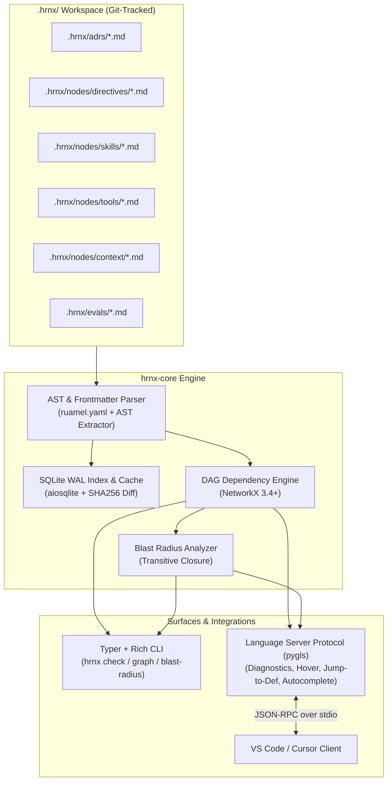

# HRNX Core (`hrnx-core`)

> **The AI-Native Harness Engineering IDE — Core Engine & Backend**

[](https://www.python.org/)
[](https://opensource.org/licenses/Apache-2.0)
[](https://docs.pydantic.dev/)
[](https://networkx.org/)
[](https://github.com/openlawlibrary/pygls)

---

## 1. Executive Summary

**HRNX** (pronounced *"Harnex"*) is an open-core, file-backed, AI-native Harness Engineering platform designed to author, compile, validate, maintain, and govern AI coding-agent harnesses at enterprise scale.

Rather than fragmenting harness logic across disjointed agent configs or fragile markdown prompts, **HRNX decouples canonical engineering intent** (architectural invariants, domain models, procedural workflows, safety boundaries) from **agent-specific runtime artifacts** (Claude Code, Antigravity, OpenAI Codex, OpenHands, GitHub Copilot, Cursor, Windsurf, Aider, Cline/Roo Code, Goose).

`hrnx-core` contains the foundation: **the canonical schema engine, AST frontmatter parser, NetworkX dependency DAG, blast radius calculator, WAL SQLite cache, Language Server Protocol (`hrnx-lsp`) daemon, and rich CLI**.

---

## 2. Architecture & Data Flow



---

## 3. Component Deep Dive (Stream 1)

### 3.1 Canonical Schema Engine (`hrnx.models`)
Built on **Pydantic v2** for sub-millisecond validation. Every asset in the harness is a typed [`HarnessNode`](file:///c:/Research/HRNX/hrnx-core/src/hrnx/models/schema.py#L195-L198):

| Node Type | Class | Description | Key Attributes |
|---|---|---|---|
| **Directive** | [`Directive`](file:///c:/Research/HRNX/hrnx-core/src/hrnx/models/schema.py#L11-L41) | Architectural invariants, security policies, coding rules | `severity: "fatal_invariant" \| "warning" \| "advisory"`, `implements: [ADR]`, `validated_by: [Eval]`, `targets` |
| **Skill** | [`Skill`](file:///c:/Research/HRNX/hrnx-core/src/hrnx/models/schema.py#L44-L73) | Procedural workflows, recipes, operational runbooks | `uses_tools: [Tool]`, `triggers: [str]`, `preconditions`, `implements` |
| **Tool** | [`ToolSpec`](file:///c:/Research/HRNX/hrnx-core/src/hrnx/models/schema.py#L76-L103) | Execution tool, function calling, or MCP declarations | `provider: "bash" \| "mcp" \| "python" \| "http"`, `parameters`, `permissions`, `read_only` |
| **Context Slice** | [`ContextSlice`](file:///c:/Research/HRNX/hrnx-core/src/hrnx/models/schema.py#L106-L120) | Token budgeting and dynamic context retrieval scoping | `globs: [str]`, `budget_tokens: int`, `priority: 1..100` |
| **Evaluation** | [`EvalSpec`](file:///c:/Research/HRNX/hrnx-core/src/hrnx/models/schema.py#L139-L170) | Automated behavioral test harnesses and assertions | `validates: [Directive]`, `target_agents`, `prompt`, `assertions` |
| **ADR** | [`ADR`](file:///c:/Research/HRNX/hrnx-core/src/hrnx/models/schema.py#L173-L192) | Architectural Decision Records capturing durable rationale | `status: "proposed" \| "accepted" \| "superseded"`, `deciders`, `date` |

### 3.2 AST Frontmatter & Content Parser (`hrnx.parser.ast`)
- **Bi-directional Parsing**: Extracts YAML frontmatter into strongly typed Pydantic models while preserving the Markdown AST body verbatim.
- **Format-Preserving Round-Tripping**: Powered by `ruamel.yaml` to ensure existing comments, key ordering, and whitespace are retained during programmatic updates.
- **Precise Location Tracking**: Records 1-indexed line and column positions for YAML keys and Markdown body cross-references (`@ref:`, `@dir.`, `@skill.`, `@tool.`, `ADR-XXX`, `[label](target)`).

### 3.3 Dependency Graph Engine (`hrnx.graph.dag`)
- **NetworkX DiGraph**: In-memory representation connecting all nodes via typed edges:
  - `depends_on`: Direct functional dependencies.
  - `implements`: Directive or Skill realizing an ADR.
  - `validates`: EvalSpec asserting invariant compliance.
  - `uses_tool`: Skill requiring a ToolSpec.
  - `overrides`: Superseding deprecated directives.
- **Cycle Detection**: Detects circular dependency loops (e.g., `A -> B -> C -> A`) with exact cycle paths.
- **Topological Sorting**: Computes deterministic compilation and execution orders.
- **Dangling Reference Detection**: Flags broken edges pointing to non-existent nodes.
- **ADR Governance**: Tracks which ADRs have zero implementing directives.
- **Mermaid Export**: Emits instant visualization diagrams (`to_mermaid()`).

### 3.4 Blast Radius & Impact Analyzer (`hrnx.graph.blast_radius`)
When an engineer or agent modifies a directive, the analyzer determines the downstream consequences:
- **Direct Dependents**: Nodes with immediate edges to the origin.
- **Transitive Dependents**: Complete reverse topological closure.
- **Required Evals**: Test suites that MUST be re-executed before merging.
- **Fatal Invariant Impact**: Highlights high-risk safety boundaries in the blast zone.
- **Affected Target Agents**: Identifies which agent files (`CLAUDE.md`, `.cursorrules`, etc.) require regeneration.

### 3.5 Local Indexing & WAL Cache (`hrnx.index.cache`)
- **SQLite with WAL Mode**: Configured with `PRAGMA journal_mode = WAL;` and `PRAGMA synchronous = NORMAL;`.
- **Incremental Scanning**: Compares file `mtime` and SHA-256 hashes so unchanged files bypass parsing overhead.
- **Dual APIs**: Synchronous interface for CLI responsiveness; asynchronous interface (`aiosqlite`) for the LSP daemon.

### 3.6 Language Server Protocol (`hrnx.server.lsp`)
A standards-compliant LSP server built with `pygls 2.x` and `lsprotocol`:
- **Diagnostics**: Real-time squiggly underlines for broken dependencies, cyclic loops, missing ADR implementations, and schema errors.
- **Autocomplete**: Context-aware suggestions under `depends_on:`, `implements:`, `validated_by:`, and body `@ref:` references.
- **Hover Provider**: Rich Markdown hover cards detailing node status, severity, direct dependencies, and blast radius.
- **Go-To-Definition**: Jumps directly to the file and line number defining referenced nodes.
- **Code Actions**: Quick-fixes to add missing dependencies to frontmatter and generate skeleton `EvalSpec` files.

### 3.7 Terminal CLI (`hrnx.cli.main`)
An interactive terminal experience powered by `typer` and `rich`.

---

## 4. Installation & Setup

### Prerequisites
- Python 3.10+ (Python 3.12 recommended)
- `uv` (recommended) or `pip`

### Installation
From the `hrnx-core` directory:

```bash
# Using uv (fastest)
uv pip install -e ".[dev]"

# Or using standard pip
pip install -e ".[dev]"
```

Verify installation:
```bash
hrnx --help
```

---

## 5. CLI Command Reference

### `hrnx init [PATH]`
Scaffolds a new `.hrnx` directory structure with starter ADRs, directives, tools, skills, context slices, and evals:
```bash
$ hrnx init .
[+] Initialized HRNX Workspace at /path/to/repo/.hrnx
+-- config.yaml
+-- adrs/ -> ADR-001-db-migrations.md
+-- nodes/directives/ -> dir.db.zero-downtime.md
+-- nodes/skills/ -> skill.db.run-migration.md
+-- nodes/tools/ -> tool.db.psql-executor.md
+-- nodes/context/ -> ctx.db.schema-slice.md
`-- evals/ -> eval.db.prevent-drop.md
```

### `hrnx check [PATH]`
Validates all schemas, cyclic dependency loops, dangling references, and ADR governance:
```bash
$ hrnx check .
+------------------------------ HRNX Validator -------------------------------+
| HRNX Health Inspection: /path/to/repo                                       |
| Total Nodes: 6 | Status: PASSED                                             |
+-----------------------------------------------------------------------------+
[+] All schemas, dependencies, and invariants validated successfully.
```
*(Exits with code 0 on pass, 1 on errors — ready for CI/CD pipelines).*

### `hrnx blast-radius <NODE_ID>`
Calculates the downstream impact and required test suites for any node:
```bash
$ hrnx blast-radius dir.db.zero-downtime
+-----------------------------------------------------------------------------+
| Blast Radius Analysis for: dir.db.zero-downtime                             |
+-------------------------- Total Impacted Nodes: 3 --------------------------+
+--------------------------------------------------------------------------+
| Category                  | Impacted Assets                              |
|---------------------------+----------------------------------------------|
| Direct Dependents         | eval.db.prevent-drop, skill.db.run-migration |
| Transitive Dependents     | eval.db.prevent-drop, skill.db.run-migration |
| Impacted Fatal Invariants | dir.db.zero-downtime                         |
| Impacted Skills           | skill.db.run-migration                       |
| Required Evals to Re-run  | eval.db.prevent-drop                         |
| Affected Target Agents    | claude, cursor                               |
+--------------------------------------------------------------------------+
```

### `hrnx graph [--format=table|mermaid|json]`
Outputs the topological compilation order or exports a visual graph:
```bash
$ hrnx graph --format mermaid
flowchart TD
    ADR_001["ADR-001<br/><i>Zero-Downtime Database Migration Policy</i>"]
    dir_db_zero_downtime["dir.db.zero-downtime<br/><i>Zero-Downtime Database Migrations</i>"]
    ...
```

### `hrnx info`
Displays workspace summary, active targets, and node distributions:
```bash
$ hrnx info
+------------------------ HRNX Workspace Information -------------------------+
| Project Name: enterprise-harness                                            |
| Active Agent Targets: claude, antigravity, codex, cursor, copilot           |
| Total Harness Nodes: 6                                                      |
+-----------------------------------------------------------------------------+
```

### `hrnx lsp`
Runs the Language Server Protocol over standard input/output (used by VS Code / Cursor extensions).

---

## 6. Canonical Node Example

Here is an example canonical directive (`.hrnx/nodes/directives/dir.db.zero-downtime.md`):

```markdown
---
id: dir.db.zero-downtime
title: Zero-Downtime Database Migrations
type: directive
severity: fatal_invariant
status: active
implements:
  - ADR-001
validated_by:
  - eval.db.prevent-drop
rationale: "Prevents accidental data loss and table locking during agent-assisted database refactoring"
targets:
  claude:
    enabled: true
  cursor:
    globs: ["migrations/**/*.sql", "prisma/**/*.prisma"]
---

# Zero-Downtime Database Migrations

AI agents must never generate destructive DDL operations without multi-phase migration steps.

## Invariant Rules
1. `DROP TABLE` and `DROP COLUMN` are strictly prohibited.
2. New columns must be added as `NULLABLE` or have explicit default values.
3. Adding indexes on large tables must use `CONCURRENTLY` (PostgreSQL).
Refer to @ref:ADR-001 for architectural rationale.
```

---

## 7. Development & Verification

Run the test suite with `pytest`:

```bash
pytest -v
```

Output:
```text
tests/test_blast_radius.py::test_blast_radius_calculation PASSED         [  4%]
tests/test_cli.py::test_cli_init_and_check PASSED                        [  8%]
tests/test_graph.py::test_graph_building_and_dependencies PASSED         [ 12%]
tests/test_graph.py::test_cycle_detection PASSED                         [ 16%]
tests/test_graph.py::test_dangling_references PASSED                     [ 20%]
tests/test_graph.py::test_adr_coverage PASSED                            [ 24%]
tests/test_graph.py::test_to_mermaid PASSED                              [ 28%]
tests/test_index.py::test_node_cache_sync_and_async PASSED               [ 32%]
tests/test_lsp.py::test_lsp_diagnostics_broken_dep PASSED                [ 36%]
tests/test_lsp.py::test_lsp_completions PASSED                           [ 40%]
tests/test_lsp.py::test_lsp_hover PASSED                                 [ 44%]
tests/test_lsp.py::test_lsp_definition PASSED                            [ 48%]
tests/test_lsp.py::test_lsp_code_actions PASSED                          [ 52%]
tests/test_models.py::test_directive_validation PASSED                   [ 56%]
tests/test_models.py::test_directive_invalid_severity PASSED             [ 60%]
tests/test_models.py::test_skill_validation PASSED                       [ 64%]
tests/test_models.py::test_toolspec_validation PASSED                    [ 68%]
tests/test_models.py::test_context_slice_validation PASSED               [ 72%]
tests/test_models.py::test_evalspec_validation PASSED                    [ 76%]
tests/test_models.py::test_adr_validation PASSED                         [ 80%]
tests/test_models.py::test_harness_node_discriminated_union PASSED       [ 84%]
tests/test_parser.py::test_parse_valid_directive PASSED                  [ 88%]
tests/test_parser.py::test_parse_yaml_syntax_error PASSED                [ 92%]
tests/test_parser.py::test_parse_unterminated_frontmatter PASSED         [ 96%]
tests/test_parser.py::test_round_trip_serialization PASSED               [100%]

============================= 35 passed in 3.89s ==============================
```

---

## 8. Stream 4: Validation, Sandbox & Evaluation Infrastructure

`hrnx-core` incorporates an automated regression test and conformance verification bench:

### CLI Commands:
```bash
# Run evaluations in isolated local sandbox
hrnx eval run

# Run specific evaluation against a single agent target
hrnx eval run --id eval.db.prevent-drop --target claude

# Output cross-agent conformance benchmark matrix
hrnx eval matrix

# Use Docker micro-sandbox (when Docker daemon is running)
hrnx eval run --sandbox docker
```

---

## 9. Stream 5: Multiplayer Collaboration, Semantic Merge & Git Synchronization

HRNX provides enterprise-grade collaboration primitives, conflict-free AST merges, and atomic repository synchronization:

### 9.1 Ephemeral Multiplayer Collaboration Relay (`hrnx.relay`)
- **Real-Time WebSocket Relay**: Built on `websockets` over asyncio (`hrnx share`), hosting ephemeral peer sessions without polluting git history or dirtying disk.
- **Peer Presence**: Tracks active engineers, cursor focus, and currently inspected nodes in real time.
- **In-Memory Draft Promotion**: Team members can co-author harness nodes in shared scratchpad drafts, promoting them to canonical `.hrnx` nodes only after consensus and evaluation checks.
- **Review & Comment Threads**: Supports threaded discussions pinned to nodes or DAG coordinates, persisted to `.hrnx/.cache/comments.json`.

```bash
# Spin up collaboration relay for a team session
hrnx share --port 8765 --room platform-core
```

### 9.2 Custom 3-Way AST Semantic Merge Driver (`hrnx.git.semantic_merge`)
Standard Git textual 3-way merge (`git merge`) regularly causes false conflicts on multi-author additions to YAML lists (`depends_on`, `implements`) or target metadata blocks. HRNX provides an AST-aware semantic merge engine:
- **Set Union Merging**: Additions to `depends_on`, `implements`, and tags from both branches are automatically unioned without conflict.
- **Field-Level Granularity**: Conflicts are isolated to specific frontmatter attributes or markdown sections rather than corrupting the entire document.
- **Smart Combine**: Resolves competing string additions into cohesive composite directives.
- **Git Driver Protocol**: Integrates with Git via `.git/config` (`merge.hrnx-merge-driver`) returning exit code `0` on clean merge and writing merged content to `%A`.

```bash
# Install git merge driver and pre-commit hooks
hrnx git install-hooks

# Run merge driver directly (used by git automatically during merge/rebase)
hrnx merge-driver <ancestor-path> <ours-path> <theirs-path> <relative-file-path>
```

### 9.3 Atomic Multi-Target Commit & Pre-Commit Enforcement (`hrnx.git.commit_manager`)
Prevents **target drift** (canonical nodes updated while generated target configs like `CLAUDE.md` or `.cursorrules` remain stale):
- **Staged Sync Check (`hrnx git status`)**: Inspects staged git files. If any `.hrnx/nodes/*.md` file is staged without its compiled target files, warns or blocks commit.
- **Atomic Multi-Target Commit (`hrnx commit`)**: Automatically recompiles all active targets (`claude`, `antigravity`, `codex`, `cursor`, etc.), stages both canonical nodes and targets together in Git's index, and executes an atomic commit.
- **Automated Git Pre-Commit Hook**: Installed via `hrnx git install-hooks` for cross-platform Bash and Windows execution.

```bash
# Check git staging sync status
hrnx git status

# Atomically compile all active agent targets, stage, and commit
hrnx commit -m "feat(auth): add fatal invariant for OAuth state verification"
```

---

## 10. Development & Verification

Run the test suite with `pytest`:

```bash
pytest -v
```

Output:
```text
tests/test_blast_radius.py::test_blast_radius_calculation PASSED         [  2%]
tests/test_cli.py::test_cli_init_and_check PASSED                        [  4%]
tests/test_eval.py::test_deterministic_assertions PASSED                 [  7%]
tests/test_eval.py::test_judge_mock_and_hybrid PASSED                    [  9%]
tests/test_eval.py::test_judge_real_gemini PASSED                        [ 11%]
tests/test_eval.py::test_sandbox_local_execution PASSED                  [ 14%]
tests/test_eval.py::test_evaluation_runner_end_to_end PASSED             [ 16%]
tests/test_graph.py::test_graph_building_and_dependencies PASSED         [ 19%]
tests/test_graph.py::test_cycle_detection PASSED                         [ 21%]
tests/test_graph.py::test_dangling_references PASSED                     [ 23%]
tests/test_graph.py::test_adr_coverage PASSED                            [ 26%]
tests/test_graph.py::test_to_mermaid PASSED                              [ 28%]
tests/test_index.py::test_node_cache_sync_and_async PASSED               [ 30%]
tests/test_lsp.py::test_lsp_diagnostics_broken_dep PASSED                [ 33%]
tests/test_lsp.py::test_lsp_completions PASSED                           [ 35%]
tests/test_lsp.py::test_lsp_hover PASSED                                 [ 38%]
tests/test_lsp.py::test_lsp_definition PASSED                            [ 40%]
tests/test_lsp.py::test_lsp_code_actions PASSED                          [ 42%]
tests/test_models.py::test_directive_validation PASSED                   [ 45%]
tests/test_models.py::test_directive_invalid_severity PASSED             [ 47%]
tests/test_models.py::test_skill_validation PASSED                       [ 50%]
tests/test_models.py::test_toolspec_validation PASSED                    [ 52%]
tests/test_models.py::test_context_slice_validation PASSED               [ 54%]
tests/test_models.py::test_evalspec_validation PASSED                    [ 57%]
tests/test_models.py::test_adr_validation PASSED                         [ 59%]
tests/test_models.py::test_harness_node_discriminated_union PASSED       [ 61%]
tests/test_parser.py::test_parse_valid_directive PASSED                  [ 64%]
tests/test_parser.py::test_parse_yaml_syntax_error PASSED                [ 66%]
tests/test_parser.py::test_parse_unterminated_frontmatter PASSED         [ 69%]
tests/test_parser.py::test_round_trip_serialization PASSED               [ 71%]
tests/test_server_handlers.py::test_server_handlers_end_to_end PASSED    [ 73%]
tests/test_server_handlers.py::test_preview_transpile_with_pygls_object PASSED [ 76%]
tests/test_stream5.py::test_relay_session_presence_and_drafts PASSED     [ 78%]
tests/test_stream5.py::test_comment_store PASSED                         [ 80%]
tests/test_stream5.py::test_semantic_3way_merge_clean_non_conflicting PASSED [ 83%]
tests/test_stream5.py::test_semantic_3way_merge_scalar_conflict PASSED   [ 85%]
tests/test_stream5.py::test_git_manager_hook_and_driver_installation PASSED [ 88%]
tests/test_stream5.py::test_lsp_stream5_handlers PASSED                  [ 90%]
tests/test_transpiler.py::test_transpiler_all_targets PASSED             [ 92%]
tests/test_transpiler.py::test_transpiler_node_previews PASSED           [ 95%]
tests/test_compatibility_diagnostics PASSED          [ 97%]
tests/test_transpiler.py::test_drift_inspection_and_reconcile PASSED     [100%]

============================= 42 passed in 7.08s ==============================
```

---

## 11. Roadmap & Phased Streams

| Stream | Description | Status |
|---|---|---|
| **Stream 1** | **Core Engine & Backend Architecture** (Schemas, Parser, DAG, Cache, LSP, CLI) | **Completed** |
| **Stream 2** | **Frontend & IDE Experience** (VS Code / Cursor extension, split canvas, React Flow) | **Completed** |
| **Stream 3** | **Universal Agent Adapters & Transpilation** (Claude, Codex, Antigravity, Cursor, Copilot, etc.) | **Completed** |
| **Stream 4** | **Validation, Ephemeral Sandboxes & Evals** (Evaluation runner, hybrid LLM judge, conformance matrix) | **Completed** |
| **Stream 5** | **Multiplayer Collaboration & Git Merge** (Relay server, 3-way AST merge driver, atomic commits) | **Completed** |
| **Stream 6** | **Enterprise Governance, Provenance & CI/CD** (Ed25519 signatures, GitHub Actions gate) | Upcoming |

